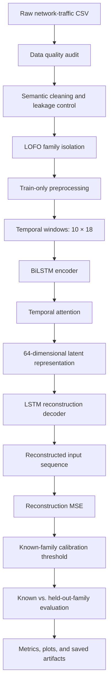

# FedEVT-OSAD

## Federated Extreme-Value Open-Set Anomaly Detection

### BiLSTM + Temporal Attention + Autoencoder --- Research Backbone

```{=html}
<p align="center">
```
`<strong>`{=html}A research-oriented framework for evaluating
generalization to previously unseen cyber-threat
families.`</strong>`{=html}
```{=html}
</p>
```
```{=html}
<p align="center">

</p>
```
FedEVT-OSAD explores open-set and zero-day anomaly detection in network
traffic. Its current implementation establishes a sequence-learning
backbone using a **Bidirectional LSTM (BiLSTM), learned temporal
attention, and an LSTM autoencoder decoder**. It learns to reconstruct
network-traffic windows and uses reconstruction error as an initial
anomaly score.

The experiment uses a **Leave-One-Family-Out (LOFO)** protocol: the
`WannaCry` family is held out from model development and used for
zero-day evaluation. The current baseline deliberately reports its
measured limitations rather than assuming that unseen attacks must
produce high reconstruction error.

> **Research status:** This repository/notebook documents the neural
> baseline. Latent-prototype novelty scoring, fused novelty scoring,
> Extreme Value Theory (EVT) calibration, and federated aggregation are
> planned extensions and must not be treated as implemented unless
> separately added and validated.

------------------------------------------------------------------------

## Contents

-   [Research objective](#research-objective)
-   [Architecture at a glance](#architecture-at-a-glance)
-   [Model architecture](#model-architecture)
-   [LOFO evaluation protocol](#lofo-evaluation-protocol)
-   [Data cleaning and preprocessing](#data-cleaning-and-preprocessing)
-   [Training and scoring](#training-and-scoring)
-   [Evaluation metrics](#evaluation-metrics)
-   [Observed baseline findings](#observed-baseline-findings)
-   [Repository outputs](#repository-outputs)
-   [Environment and installation](#environment-and-installation)
-   [Running the notebook](#running-the-notebook)
-   [Configuration](#configuration)
-   [Reproducibility and integrity
    checks](#reproducibility-and-integrity-checks)
-   [Limitations and next research
    steps](#limitations-and-next-research-steps)
-   [Author](#author)

------------------------------------------------------------------------

## Research objective

Traditional closed-set classifiers learn to distinguish among attack
families represented in their training data. In operational security,
however, a detector may encounter a family that was not observed during
development.

FedEVT-OSAD studies a different question:

> **Can a temporal representation learned from known network traffic
> provide useful evidence when the detector encounters a previously
> unseen attack family?**

The current implementation is the first-stage neural baseline. It learns
to reconstruct temporal windows and treats reconstruction error as a
candidate novelty signal. LOFO evaluation measures how well this score
separates a held-out family from known-family evaluation traffic.

The autoencoder is trained with a reconstruction objective, not a
supervised attack-family classification loss. `Family` is used to
construct partitions and calculate post-hoc evaluation labels; it is not
a model input.

## Architecture at a glance



**Important:** the diagram shows the implemented neural baseline and its
empirical thresholding/evaluation path. EVT fitting, latent-prototype
scoring, and federated aggregation are future modules, not part of this
baseline unless explicitly implemented in the code.

## Model architecture

The notebook preserves the following backbone:

  -----------------------------------------------------------------------
  Component                           Role
  ----------------------------------- -----------------------------------
  Input window                        Sequence of 10 timesteps, each with
                                      18 transformed features in the
                                      current configuration

  Two-layer BiLSTM encoder            Encodes context from both
                                      directions across the input window

  Temporal attention                  Learns weights over timesteps and
                                      computes an attention-weighted
                                      representation

  Latent projection                   Maps the context into a
                                      64-dimensional latent vector

  LSTM decoder                        Reconstructs the original input
                                      sequence from the latent
                                      representation

  Reconstruction error                Computes mean squared error between
                                      the input and reconstructed
                                      sequence
  -----------------------------------------------------------------------

The expected model input shape is:

``` text
(batch_size, window_size, feature_count)
(batch_size, 10, 18)
```

The output reconstruction is expected to match the input shape. The
actual feature count must be verified when the dataset or encoder
vocabulary changes.

### Reconstruction score

For window (x_i) and reconstructed window (`\hat{x}`{=tex}\_i), the
score is mean squared reconstruction error:

\[ R_i =
`\frac{1}{TF}`{=tex}`\sum`{=tex}*{t=1}\^{T}`\sum`{=tex}*{j=1}\^{F}
(x\_{i,t,j}-`\hat{x}`{=tex}\_{i,t,j})\^2 \]

where (T=10) and (F=18) in the current feature configuration.

A larger value indicates a larger reconstruction mismatch. It does
**not** guarantee that the sample is malicious or belongs to an unseen
family; that relationship must be established empirically.

## LOFO evaluation protocol

### Held-out family

The current configuration sets:

``` python
CONFIG["held_out_family"] = "WannaCry"
```

All records from the selected family are excluded from training,
validation, calibration, and known-family evaluation. They are used only
for the final held-out-family evaluation.

The notebook's documented dataset counts are:

  ------------------------------------------------------------------------
  Partition             Purpose               Expected record count in the
                                                            documented run
  --------------------- --------------------- ----------------------------
  Training              Optimize the                               106,346
                        autoencoder           

  Validation            Monitor validation                          13,293
                        reconstruction loss   

  Threshold calibration Set the empirical                            6,647
                        threshold             

  Known-family          Measure false alarms                         6,647
  evaluation            on known families     

  Held-out WannaCry     Evaluate                                    16,110
  test                  unseen-family         
                        detection             

  **Total**                                                    **149,043**
  ------------------------------------------------------------------------

These counts describe the documented run and must be re-verified from
the dataset and current notebook execution. Temporal window counts are
lower because a window requires 10 records.

### Why LOFO matters

A random sample-level split can place records from the same attack
family in both development and test data. LOFO instead removes the
selected family entirely from model development, making the held-out
evaluation a more direct test of cross-family generalization.

LOFO is a **data-partitioning protocol**, not a neural-network layer.

### Threshold calibration

The baseline uses the empirical 95th percentile of reconstruction errors
from the known-family calibration partition:

\[ `\tau `{=tex}= Q\_{0.95}(R\_{`\mathrm{calibration}`{=tex}}) \]

The decision rule is:

\[ `\hat{y}`{=tex}\_i =
```{=tex}
\begin{cases}
1 & \text{if } R_i > \tau\\
0 & \text{otherwise}
\end{cases}
```
\]

Here, `1` means "flagged as anomalous / held-out-family candidate," and
`0` means "not flagged." The threshold is calculated without using
WannaCry test labels or scores. A percentile threshold is an empirical
operating point; it is **not EVT calibration**.

## Data cleaning and preprocessing

The preprocessing pipeline is designed to protect evaluation integrity
and avoid direct label/identity leakage.

### 1. Data quality audit

The documented dataset audit reports approximately 149,043 rows and 14
raw columns. It checks schema, data types, missing values, infinite
numerical values, duplicate records, categorical distributions, and
family counts. Re-run the audit against the exact dataset used for an
experiment rather than assuming these counts always apply.

### 2. Semantic cleaning

Known column spelling issues are normalized, including `Protcol` to
`Protocol` and `SeddAddress` to `SeedAddress`. String columns are
trimmed to reduce accidental category duplication caused by whitespace.
Records are not automatically removed as outliers or duplicates without
evidence.

### 3. Leakage control and feature selection

The notebook excludes direct identifiers and target-like fields from the
model inputs. In particular, `Family` is retained for LOFO splitting and
post-hoc evaluation but dropped from the feature matrix. `Prediction`
and `Threats` are excluded from model inputs. IP/address-like
identifiers and `Port` are also excluded in the current configuration.

The current candidate feature set is:

-   **Numerical:** `Clusters`, `BTC`, `USD`, `Netflow_Bytes`,
    `hour_sin`, `hour_cos`
-   **Categorical:** `Protocol`, `Flag`

The exact schema and feature list must be checked against the real CSV
before each run.

### 4. Time-feature validation

The notebook currently derives `hour_sin` and `hour_cos` from `Time`
using a 86,400-unit cycle. This transformation is appropriate only if
`Time` is confirmed to represent seconds within a day. The observed
value range alone does not establish those semantics.

Before treating the feature engineering as final, verify the dataset
documentation and units. If `Time` is an event index, relative time, or
another quantity, use a transformation that matches its actual meaning
or exclude it. Do not describe the features as valid time-of-day
encoding without that verification.

### 5. LOFO split before fitting transformations

The selected family is isolated before the scaler and encoder are
fitted. The scaler and encoder are fitted on training records only and
then reused unchanged for validation, calibration, known-family
evaluation, and held-out test records.

### 6. Scaling and encoding

-   `StandardScaler` is used for numerical features.
-   `OneHotEncoder(handle_unknown="ignore", sparse_output=False)` is
    used for categorical features, subject to installed scikit-learn
    compatibility.
-   The final feature order is retained for model compatibility.
-   Preprocessing objects are saved under `results/checkpoints/`.

### 7. Temporal windows

The current window length is 10. The intended tensor format is
`(N, 10, 18)`. Windows are created separately within each partition to
prevent crossing partition boundaries.

For scientifically meaningful sequence learning, row order and session
boundaries matter. Verify that the source records are ordered
appropriately and, when available, group windows by a real
session/flow/device sequence identifier. The current notebook should not
be described as producing true continuous network sequences unless the
dataset supports that interpretation.

## Training and scoring

The documented configuration is:

  Parameter                               Value
  ------------------------ --------------------
  Random seed                                42
  Window size                                10
  Hidden size                                64
  BiLSTM layers                               2
  Latent dimension                           64
  Dropout                                   0.2
  Batch size                                128
  Maximum epochs                             50
  Optimizer                                Adam
  Learning rate                           0.001
  Weight decay                          0.00001
  Gradient clipping                         1.0
  Loss                       Mean Squared Error
  Scheduler                   ReduceLROnPlateau
  Scheduler factor                          0.5
  Scheduler patience                          5
  Calibration percentile                     95

The notebook tracks training and validation reconstruction loss, saves
the best checkpoint, restores it before scoring, and calculates
reconstruction scores in inference mode. The effective device (CPU,
CUDA, or Apple Silicon MPS when available) and versions should be
recorded from the actual execution.

## Evaluation metrics

The notebook evaluates the binary task:

-   **Negative class (`0`):** known-family evaluation traffic.
-   **Positive class (`1`):** held-out WannaCry traffic.

It computes, where supported:

-   Accuracy
-   Precision
-   Recall / detection rate
-   F1-score
-   Balanced accuracy
-   Specificity
-   False-positive rate (FPR)
-   False-negative rate (FNR)
-   Confusion matrix
-   ROC-AUC using continuous reconstruction scores
-   PR-AUC / average precision using continuous reconstruction scores

Accuracy alone is not sufficient for an imbalanced or open-set detection
problem. Recall, FPR, balanced accuracy, and the score distributions are
important to interpret together. AUC metrics measure ranking quality
across thresholds and do not depend on only one thresholded prediction
vector.

## Observed baseline findings

The notebook's documented empirical section reports:

  Measurement                                             Documented result
  ----------------------------------------------------- -------------------
  Median known-family validation reconstruction error              0.009996
  Median held-out WannaCry reconstruction error                    0.007672
  Empirical 95th-percentile threshold                                0.2336
  WannaCry detection rate / recall                                    1.14%
  Reported ROC-AUC                                                   0.4524

These are **documented notebook findings, not guaranteed results for
every run**. Recompute and verify them from the current execution
outputs and result files before publishing or comparing experiments.

The held-out family's median reconstruction error is lower than the
known-family median in the documented run. The reported ROC-AUC is also
below 0.50. These results indicate that reconstruction error alone did
not reliably rank WannaCry as more anomalous than known-family traffic
in that experiment.

This is an important negative result. It suggests that reconstruction
error alone is not sufficient for the current open-set detection
objective. It does not prove that all autoencoders are inherently
incapable of zero-day detection.

The notebook's Markdown narrative and saved metrics should always be
synchronized to the same execution. If thresholds or metrics disagree
across cells or artifacts, resolve the inconsistency before citing the
result.

## Repository outputs

The notebook writes experiment outputs under `results/`:

``` text
results/
├── config.json
├── checkpoints/
│   ├── best_model.pt
│   ├── scaler.joblib
│   └── ohe.joblib
├── figures/
│   ├── dataset_distributions.png
│   ├── training_curves.png
│   ├── reconstruction_known_dist.png
│   └── ...
├── metrics/
│   ├── data_audit.json
│   ├── lofo_metrics.json
│   ├── lofo_predictions.csv
│   ├── reconstruction_scores.csv
│   └── experiment_summary.json
└── logs/
```

Exact filenames depend on the executed notebook version. Confirm that
files exist and correspond to the current configuration before using
them in a report.

## Environment and installation

### Requirements

The implementation uses Python, PyTorch, NumPy, pandas, scikit-learn,
Matplotlib, Seaborn, and joblib.

Create and activate a virtual environment:

``` bash
python -m venv .venv
source .venv/bin/activate
```

Install the main dependencies:

``` bash
pip install torch numpy pandas scikit-learn matplotlib seaborn joblib jupyter nbformat nbclient
```

If the environment is already configured, use its existing dependency
lock or requirements file when available. Check scikit-learn
compatibility for the `OneHotEncoder` argument `sparse_output`; older
versions use `sparse=False`.

## Running the notebook

1.  Place the dataset at `archive-2/final(2).csv`, or update
    `CONFIG["data_path"]`.
2.  Open `FedEVT_OSAD_BiLSTM_Attention_AE.ipynb` in Jupyter.
3.  Review the configuration and verify the semantics of `Time`.
4.  Execute all cells sequentially from a clean kernel.
5.  Confirm that the LOFO assertions pass and that no held-out-family
    data is used for fitting or calibration.
6.  Inspect the evaluation metrics and visualizations.
7.  Verify that the checkpoint, preprocessing artifacts, metrics, and
    prediction files were written by the current run.

To execute a notebook from the command line when `nbconvert` is
installed:

``` bash
jupyter nbconvert --to notebook --execute \
  FedEVT_OSAD_BiLSTM_Attention_AE.ipynb \
  --output FedEVT_OSAD_BiLSTM_Attention_AE.executed.ipynb
```

Use an appropriate timeout for the training workload. A successful
command should be followed by checks of the notebook outputs and
generated artifacts; do not infer scientific validity from successful
execution alone.

## Configuration

The main experiment settings are centralized in `CONFIG`:

``` python
CONFIG = {
    "seed": 42,
    "window_size": 10,
    "hidden_size": 64,
    "num_layers": 2,
    "latent_dim": 64,
    "dropout": 0.2,
    "batch_size": 128,
    "epochs": 50,
    "learning_rate": 1e-3,
    "weight_decay": 1e-5,
    "gradient_clip": 1.0,
    "benign_label": None,
    "held_out_family": "WannaCry",
    "data_path": "archive-2/final(2).csv",
    "threshold_percentile": 95.0,
    "scheduler_factor": 0.5,
    "scheduler_patience": 5
}
```

`benign_label=None` means the current configuration does not restrict
autoencoder training to benign-only traffic. It trains on the permitted
non-held-out families. Interpret the resulting score as a
known-family-versus-held-out-family baseline, not as a conventional
benign-only anomaly detector.

## Reproducibility and integrity checks

Before reporting a result:

-   Record the dataset version or hash, held-out family, random seed,
    feature list, window policy, and model configuration.
-   Confirm that preprocessing was fitted only on training records.
-   Confirm that WannaCry is absent from every development partition.
-   Confirm that the threshold was calibrated without held-out test
    data.
-   Verify that metrics are computed from actual predictions and
    continuous scores.
-   Verify that saved predictions and metrics agree.
-   Keep notebook narrative, JSON files, and figures synchronized to the
    same run.
-   Repeat LOFO with multiple held-out families before drawing broad
    conclusions about zero-day generalization.

## Limitations and next research steps

### Current limitations

1.  Reconstruction error alone did not reliably identify WannaCry as
    anomalous in the documented experiment.
2.  `Time` semantics and temporal sequence construction require
    validation before being treated as definitive temporal modeling.
3.  Session-level flow records may not represent continuous raw packet
    sequences.
4.  The current training configuration uses all non-held-out families
    unless benign-only training is explicitly configured.
5.  One held-out family is not enough to establish generalization across
    all unseen attack families.
6.  This is a research baseline, not a production-hardened
    intrusion-detection service.

### Planned extensions

The broader FedEVT-OSAD research roadmap includes:

1.  **Latent prototype-distance novelty:** measure distance between
    latent representations and known-family prototypes.
2.  **Fused novelty score:** combine normalized reconstruction error
    with latent-space novelty.
3.  **EVT calibration:** fit a Generalized Pareto Distribution to an
    appropriate score tail using a documented Peaks-Over-Threshold
    procedure.
4.  **Federated aggregation:** explore sharing or aggregating local
    statistical evidence without centrally pooling raw traffic.
5.  **Cross-family evaluation:** repeat LOFO experiments across multiple
    attack families and report per-family and aggregate performance.

These are future research directions. They should only be marked
implemented after code, experiments, and validation support that claim.

## Author

**Saptarshi Mondal**\
Computer Science & Engineering (AI & ML)

Research interests: deep learning, cybersecurity, anomaly detection,
open-set recognition, federated learning, extreme-value theory, and
production ML systems.

------------------------------------------------------------------------

## Final perspective

FedEVT-OSAD is organized around a measurable research question, not a
guaranteed performance claim. The current BiLSTM + Temporal Attention +
Autoencoder provides a reusable temporal representation-learning
backbone. Its LOFO experiment shows that reconstruction error alone may
not be sufficiently discriminative for an unseen family under the tested
configuration.

The next step is to validate the temporal data semantics, preserve
leakage-safe evaluation, and test complementary novelty signals and
statistical calibration---while reporting results from executed
experiments rather than assumptions.
